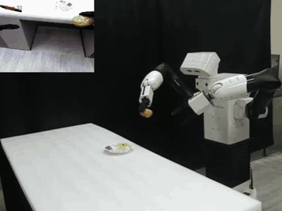
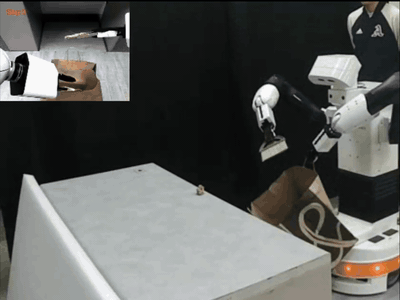
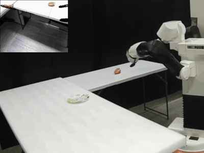
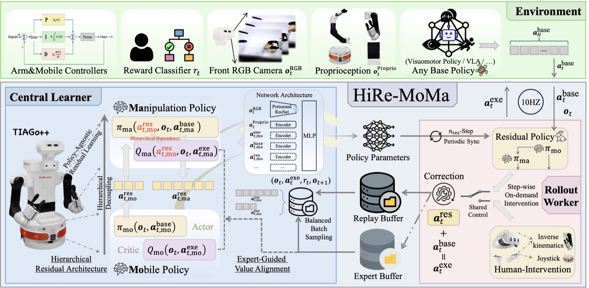
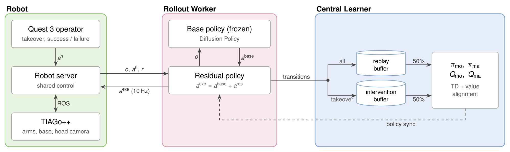

<div align="center">

<h1>
Hierarchical Residual Policy Learning for <br>
Real-World Mobile Manipulation with Sparse Human Guidance
</h1>

<h4 align="center">
<a href='https://zhefeigong.github.io/'>Zhefei Gong</a><sup>1</sup>,
<a href='https://jianghefeifei.github.io/'>Hefeifei Jiang</a><sup>2</sup>,
<a href='https://zehaowang983.github.io/'>Zehao Wang</a><sup>3</sup>,
<a href='https://jiachenli94.github.io/'>Jiachen Li</a><sup>3✉</sup>
</h4>

<sup>1</sup>Northeastern University, <sup>2</sup>University of California, Riverside, <sup>3</sup>Georgia Institute of Technology <br>
<sup>✉</sup>Corresponding author.

<a href='https://arxiv.org/abs/2610.20607'></a>
<a href='https://hire-moma.github.io/'></a>
<a href='https://2026.corl.org/'></a>

</div>

<table width="100%">
  <tr>
    <td align="center" width="33%"><br><sub><b>Place Only</b> · 2×</sub></td>
    <td align="center" width="33%"><br><sub><b>Sweep Litter</b> · 3×</sub></td>
    <td align="center" width="33%"><br><sub><b>Pick Place</b> · 4×</sub></td>
  </tr>
</table>


## 👀 Overview

> **TL;DR**: **HiRe-MoMa** fine-tunes a frozen base policy on a real mobile manipulator (TIAGo++) with a
> **hi**erarchical **re**sidual: a mobile-base head and an arm head conditioned on the base correction,
> trained by off-policy RL whose critics are aligned with sparse human interventions (< 20% of the data).

<p align="center"></p>

* **Policy-agnostic residual**: the base policy (Diffusion Policy here) stays frozen; the residual is bounded by ε = 0.3.
* **Hierarchical decoupling**: separate heads and critics for the base and the arm(s), with one-way conditioning (base → arm).
* **Expert-guided value alignment**: a preference loss ranks human actions above the agent's own actions in each critic.


## 🧩 System

<p align="center"></p>

The robot server executes the residual policy's action unless the operator takes over, and returns the human action
with the next observation. Every transition enters the replay buffer; takeovers (and the warm-up demos) also enter the
intervention buffer. The rollout worker (`train_actor.sh`, with the base policy served by `launch_base_policy.sh`) and
the central learner (`train_learner.sh`) exchange transitions and policy weights over [agentlace](https://github.com/youliangtan/agentlace).

| Folder | Runs on | Environment |
|---|---|---|
| [`hire_moma_onboard/`](hire_moma_onboard) | robot-side computer | ROS1 Noetic (PAL), Python 3.9 |
| [`hire_moma_server/`](hire_moma_server) | workstation | `hire_moma` (JAX) |
| [`diffusion_policy/`](diffusion_policy) | workstation | `hire_moma_dp` (PyTorch) |


## 📂 Structure

```
├── asset                                      # README figures (system.tex: TikZ source of system.png)
├── hire_moma_server
│   ├── hire_moma_launcher/hire_moma_launcher  # agents (hire_moma, flat_residual, hgdagger_bc), networks, buffers
│   ├── tiago_server/tiago_server
│   │   ├── exe_space
│   │   │   ├── train_residual.py              # actor / learner / evaluation
│   │   │   ├── data_collection/               # imitation demos, warm-up demos
│   │   │   ├── experiments/                   # tasks (place_only, sweep_litter, pick_place) and methods
│   │   │   └── utils/                         # normalization statistics, base + residual composition
│   │   └── tiago_env/                         # gym client of the robot server + wrappers
│   └── scripts/                               # data_collection/*.sh, residual_policy/*.sh
├── hire_moma_onboard
│   ├── tiago_onboard/tiago_onboard
│   │   ├── tiago_env/envs/tiago_env.py        # robot server (actions, shared control)
│   │   └── tiago_sys/                         # TIAGo++ control, Quest 3 teleoperation
│   └── scripts/                               # launch_onboard.sh, check_oculus.py, dump_urdf.py
└── diffusion_policy
    ├── diffusion_policy/{policy,tiago}        # model, inference server / client, dataset
    ├── tiago_train.py
    └── scripts/                               # train_base_policy.sh, launch_base_policy.sh
```


## 🔧 Installation

#### 1️⃣ Workstation: residual RL (JAX)
```bash
conda create -n hire_moma python=3.10 -y && conda activate hire_moma
pip install -e hire_moma_server/hire_moma_launcher -e hire_moma_server/tiago_server -e diffusion_policy
pip install -U "jax[cuda12]==0.4.35"
```

#### 2️⃣ Workstation: base policy (PyTorch)
```bash
conda create -n hire_moma_dp python=3.10 -y && conda activate hire_moma_dp
pip install -r diffusion_policy/requirements.txt && pip install -e diffusion_policy
```

#### 3️⃣ Robot-side computer (ROS1 Noetic with the PAL TIAGo++ packages)
```bash
conda create -n hire_moma_onboard python=3.9 -y && conda activate hire_moma_onboard
source /opt/pal/<pal-distro>/setup.bash            # rospy, tf, cv_bridge, ... from the PAL installation
pip install -r hire_moma_onboard/requirements.txt && pip install -e hire_moma_onboard/tiago_onboard
python hire_moma_onboard/scripts/dump_urdf.py      # robot URDF for TRAC-IK
```
Install the [oculus_reader](https://github.com/rail-berkeley/oculus_reader) APK on the Quest 3 and check it with
`python hire_moma_onboard/scripts/check_oculus.py --ip <quest-ip>`.
Keep all machines on a private network: the robot server has no authentication.


## 🎮 Quest 3 Controls

| Control | Effect |
|---|---|
| hold `RG` / `LG` (grip) + move the controller | teleoperate the right / left arm (overrides the policy) |
| index trigger (while holding grip) | toggle that arm's gripper |
| right joystick | drive the base forward / backward |
| left joystick (x) | rotate the base |
| `A` | start the episode after a reset (place the base first) |
| `X` / `Y` | success / failure (ends the episode) |

Any grip or joystick input is a takeover: the whole command comes from the operator and is stored as an intervention.


## 🚀 Usage

All commands run from the repository root; `<task>` is `place_only`, `sweep_litter` or `pick_place`.

```bash
# 0. robot-side computer (PAL setup sourced, ROS_MASTER_URI / ROS_IP exported)
OCULUS_IP=<quest-ip> bash hire_moma_onboard/scripts/launch_onboard.sh <task>

# on the workstation
export ROBOT_URL=http://<robot-computer-ip>:1234

# 1. teleoperated demonstrations for the base policy (paper: 80 / 100 / 200)       [hire_moma]
bash hire_moma_server/scripts/data_collection/record_imitation_demos.sh <task> 80

# 2. train and serve the base policy                                                [hire_moma_dp]
bash diffusion_policy/scripts/train_base_policy.sh <task>
bash diffusion_policy/scripts/launch_base_policy.sh <task>

# 3. warm-up buffer (>= 500 transitions of successful base-policy rollouts)          [hire_moma]
bash hire_moma_server/scripts/data_collection/record_demos.sh <task>

# 4. normalization statistics
bash hire_moma_server/scripts/data_collection/compute_stats.sh <task>

# 5. online fine-tuning: learner and actor in two terminals
bash hire_moma_server/scripts/residual_policy/train_learner.sh <task> hire_moma
bash hire_moma_server/scripts/residual_policy/train_actor.sh <task> hire_moma

# 6. evaluation (20 episodes) of a checkpoint, or of the base policy alone
bash hire_moma_server/scripts/residual_policy/eval_actor.sh <task> hire_moma 5000
bash hire_moma_server/scripts/residual_policy/eval_actor.sh <task> hire_moma 0 --base_only
```

Learner and actor resume from `runs/<task>/<method>`. Add `--debug` to disable Weights & Biases.

| `<method>` | Paper |
|---|---|
| `hire_moma` | HiRe-MoMa (Full): hierarchical decoupling + value alignment |
| `hire_moma_no_align` | +Hierarchical Decoupling, without value alignment (Tab. 2) |
| `decomposed` | +Decomposition Only: base / arm heads without conditioning (Tab. 4) |
| `flat_residual` | +Flat Residual (HIL-SERL residual) |
| `hg_dagger` | +HG-DAgger |

| `<task>` | Arms | Action | Max steps (10 Hz) |
|---|---|---|---|
| `place_only` | right | 10 = arm 6 + gripper 1 + base 3 | 500 |
| `sweep_litter` | both | 15 = 2 × arm 6 + base 3 (grippers held closed) | 500 |
| `pick_place` | right | 10 = arm 6 + gripper 1 + base 3 | 800 |


## 🙏 Acknowledgements

This code builds on [SERL](https://github.com/rail-berkeley/serl) / [HIL-SERL](https://github.com/rail-berkeley/hil-serl)
(`hire_moma_launcher` and the ResNet-10 weights, Apache-2.0), [Diffusion Policy](https://github.com/real-stanford/diffusion_policy)
(`diffusion_policy`, MIT), [TeleMoMa](https://github.com/UT-Austin-RobIn/telemoma) and [DROID](https://github.com/droid-dataset/droid)
(`tiago_sys`), [oculus_reader](https://github.com/rail-berkeley/oculus_reader) and [agentlace](https://github.com/youliangtan/agentlace).
Adapted files keep their original licenses; everything else is released under the [MIT License](LICENSE).
The TIAGo++ URDF (PAL Robotics, CC BY-NC-ND 3.0) is not included; `hire_moma_onboard/scripts/dump_urdf.py` exports it from the robot.


## 🏷️ Citation

```bibtex
@inproceedings{gong2026hiremoma,
  title     = {Hierarchical Residual Policy Learning for Real-World Mobile Manipulation with Sparse Human Guidance},
  author    = {Gong, Zhefei and Jiang, Hefeifei and Wang, Zehao and Li, Jiachen},
  booktitle = {Conference on Robot Learning (CoRL)},
  year      = {2026}
}
```
